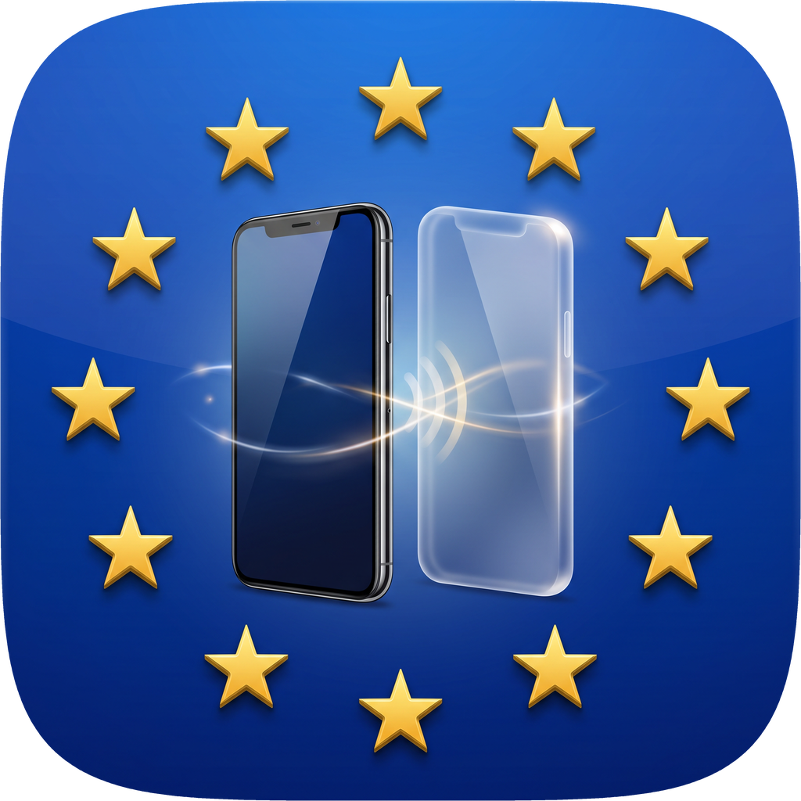
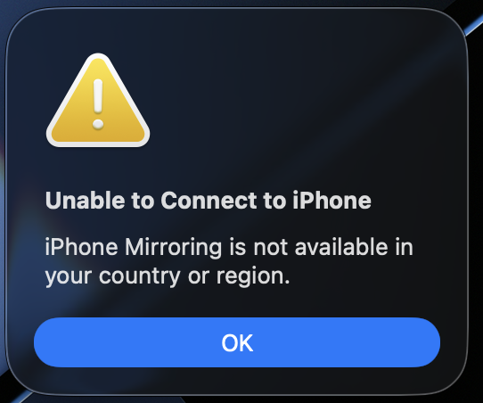

# iPhone Mirroring EU



**Getting this in the EU?**



Apple doesn't offer iPhone Mirroring in the EU. This app is the fix: it lets you see and control your iPhone from your Mac, just like iPhone Mirroring, wherever you are.

## Install

You need a Mac with Xcode, Node 20+ and an Apple ID (a free one is fine).

1. Xcode → Settings → Accounts: add your Apple ID.
2. Plug in your iPhone, unlock it, tap **Trust**.
3. iPhone: Settings → Privacy & Security → **Developer Mode** → On.
4. Run:

```bash
git clone https://github.com/yachty66/iphone-mirror && cd iphone-mirror
npm run setup   # builds the helper app for your iPhone
npm run app     # installs "iPhone Mirroring EU" to ~/Applications
```

5. Open **iPhone Mirroring EU** and allow Camera and Microphone access when asked.
6. First launch only: on the iPhone, go to Settings → General → VPN & Device Management → trust your Apple ID.

## Use

Click to tap, drag to swipe, scroll to scroll, type to type.

| Shortcut | Action |
| --- | --- |
| ⌘1 / ⌘2 / ⌘3 | Home / App Switcher / Spotlight |
| ⌘V | Paste your Mac clipboard |
| ⌘+ / ⌘− / ⌘0 | Window size |

Prefer the browser? Run `npm start` and open http://localhost:7100.

## Good to know

- Keep the iPhone unlocked and connected by USB. Setting Auto-Lock to Never helps.
- With a free Apple ID, run `npm run setup` again every 7 days.
- The iPhone's sound plays on your Mac while mirroring.
